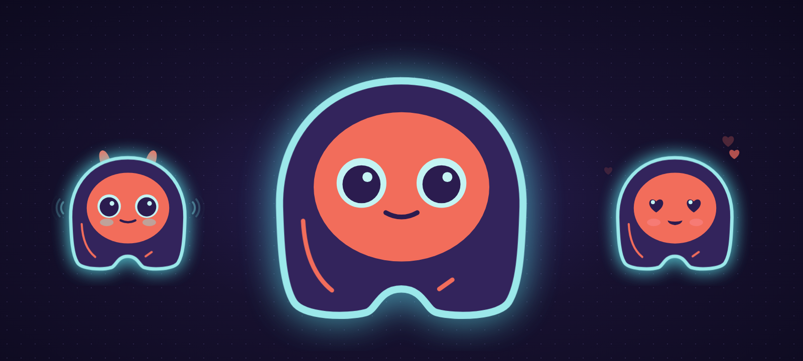
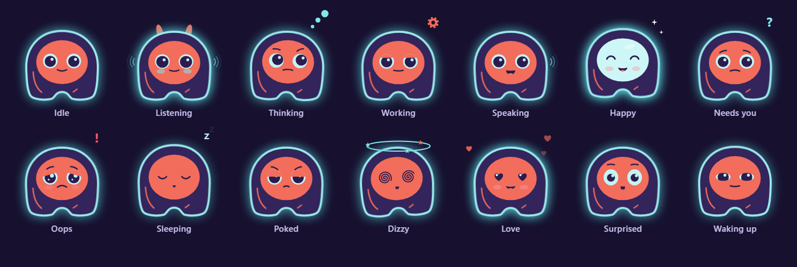
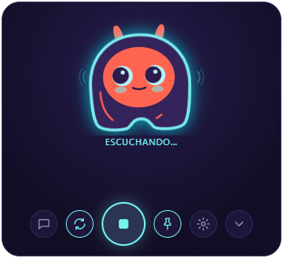

<div align="center">



# Elissa

**A voice assistant with a face, living on your Windows desktop: it works with any AI model, in the cloud or on your own PC.**

[](https://github.com/inginddie/elissa/releases)


[](https://github.com/inginddie/elissa/actions)
[](LICENSE)

[Install](#install) · [Features](#what-she-can-do) · [Privacy](#privacy-and-security) · [Roadmap](#roadmap) · [Development](#development)

</div>

---

Say **"Hey Elissa"** (or "Hola Elissa" in Spanish), or press <kbd>Ctrl</kbd>+<kbd>Alt</kbd>+<kbd>Space</kbd> from any app, and talk. Elissa listens, thinks and answers out loud.
She can read your documents, search the web, handle your email, set reminders, use your apps and remember what you
talked about. Anything that changes something waits for your click.
You choose the brain: OpenAI, Claude, Gemini, OpenRouter, Groq, or a free local model with Ollama.
When you are not talking to her, she rests as a small character in the corner of your screen.

> **Status:** 1.0. The interface is available in Spanish and English (*Settings → General → Language*).

## Meet Elissa

<p align="center"></p>

Elissa is drawn in code, not stitched from images, so she blends smoothly from one expression to the next.

- She follows your cursor across the whole desktop and blinks.
- She perks up her ears when she listens and moves her mouth with her voice.
- She shows a gear while she works and a question mark when she needs you.
- Poke her (right click) and she gets annoyed; three pokes and she gets dizzy. Rest the pointer on her and she sends hearts.
- After five quiet minutes she falls asleep, and she wakes up when you come back.

<p align="center">
  
</p>

**She stays out of your way.**
- She is a small floating bubble that grows into a card while you talk and shrinks back when she is done.
- Drag her anywhere; she expands from that corner.
- She lives in the system tray, can start with Windows and updates herself.
- She uses under 1% CPU at rest. The microphone is only on while she listens.

## What she can do

| | |
|---|---|
| 🗣️ **Talk** | Wake her with "Hey Elissa" or "Hola Elissa" (detected on your PC, offline). Voice in, voice out with natural Edge voices or offline Windows voices. Interrupt her by talking, or keep the conversation going hands-free. |
| 🔒 **Private speech, if you want** | Speech recognition can run 100% on your PC with whisper.cpp (downloaded on demand), or in the cloud with Groq/OpenAI. |
| ✋ **Act, with your OK** | Every action that changes something shows an approval card with exactly what will happen: the diff of a file, the full email, the button she'll click. Only your click approves it. |
| 📄 **Files** | Find and read PDF, Word, Excel, CSV, text and code in the folders you allow; create, edit (with a diff), move and rename. Nothing is ever deleted. Drop a file on her to ask about it. |
| 🖥️ **Use your computer** | Open apps, websites, files and folders. Read the window you're working in ("what is this?"), then click, type and press keys there. Password fields are never read. |
| ⏰ **Timers, reminders, tasks** | "Remind me at 3 pm to call Ana", "5-minute timer", "add buy bread to my tasks". She speaks up and shows a Windows notification. |
| ✉️ **Email** | Over IMAP/SMTP for Gmail, Outlook, Yahoo and iCloud: search, read, save attachments, and send if you allow it. |
| 👩‍💻 **Code with you** | Understands a project, searches the code, checks git, edits with diffs and runs your tests or builds: "run the tests, find the bug and fix it". Every edit and command needs your click; commands that delete or discard work are never run. |
| 🔔 **Claude Code & Codex alerts** | One click in Settings installs a hook so Elissa tells you when a session finishes or needs your permission, with the project's name. She never receives your prompts or the answers. |
| 🔌 **Integrations (MCP)** | Connect MCP servers, local or remote. GitHub, Jira & Confluence and Google Calendar are one click away in Settings, and any other server works too. Read-only tools run freely; anything that changes data asks first. |
| 🎵 **Music & Spotify** | "Play Daft Punk", "play my focus playlist": connect Spotify (Premium) with your own free app key and she plays what you ask for, on any of your devices. Pause, skip, "what's playing?" and volume work with any player. |
| 🌐 **Search the web** | Search and read pages, with no extra API key. |
| 🧠 **Remember** | Each conversation is summarized into plain Markdown notes she can recall later: "what did we talk about yesterday?" |
| 🔌 **Any model** | Switch providers in a guided setup that tests your key and lists the models your account can use. |

### Supported AI providers

| Provider | Key needed | Notes |
|---|---|---|
| OpenAI | ✔ | GPT models |
| Anthropic | ✔ | Claude models, through the official SDK |
| Google Gemini | ✔ | |
| OpenRouter | ✔ | Hundreds of models behind one key |
| Groq | ✔ | Very fast; also the recommended speech-to-text option |
| Ollama | — | Free and 100% local |
| LM Studio | — | Free and 100% local |
| Any OpenAI-compatible server | optional | Point Elissa at its URL |

## Install

1. Download `Elissa_x.y.z_x64-setup.exe` from the [latest release](https://github.com/inginddie/elissa/releases).
2. Run it. No administrator rights are needed.
3. Pick an AI provider and paste your API key, or choose Ollama to run everything locally.
4. To talk to her, open *Settings → Voice* and pick how she understands you: a [Groq](https://console.groq.com/keys) or
   OpenAI key, *On your PC* (private, offline, downloaded once), or your own Whisper server. Turn on "Hey Elissa" / "Hola Elissa" there
   too.

The installer is not code-signed yet, so Windows SmartScreen may warn you the first time. Choose *More info → Run anyway*.
If Microsoft Defender flags it, that's a false positive common with unsigned apps built with PyInstaller: update
Defender (`Update-MpSignature` in PowerShell) and try again, or [report it](https://www.microsoft.com/wdsi/filesubmission).
Every release is built and self-tested by GitHub Actions from this repository's code, and its updates are signed.
See the [code signing policy](docs/CODE_SIGNING.md) and the [privacy policy](PRIVACY.md).

**Requirements:** Windows 10 (1809+) or Windows 11, 64-bit, with WebView2 (built into Windows 11), a microphone and speakers.

### Everyday use

| Action | How |
|---|---|
| Talk | Say "Hey Elissa" / "Hola Elissa", press <kbd>Ctrl</kbd>+<kbd>Alt</kbd>+<kbd>Space</kbd> anywhere (configurable), or click Elissa |
| Interrupt | The same shortcut while she thinks or speaks |
| Stop talking | <kbd>Esc</kbd> in her window |
| Type instead | Chat button |
| Move | Drag her by the face |
| Hide | The ⌄ button or the tray icon; the shortcut brings her back |
| Make her sound different | *Settings → Sounds*: volume, or drop your own `listen.wav`, `done.mp3`… in the sounds folder |

## Privacy and security

The full [privacy policy](PRIVACY.md) lists every service Elissa can contact and how to turn each one off.

- **Your keys stay in Windows.** API keys and the email password are stored in the Windows Credential Manager, never in files.
- **Your data is yours.** Settings, memory and logs live in `%APPDATA%\Elissa` as readable Markdown and JSON.
  Uninstalling does not delete them.
- **Only what you choose leaves your PC.**
  - What you say goes to the AI provider you picked.
  - Your voice audio goes to the speech service you picked.
  - Nothing else leaves your PC, and there is no telemetry.
  - "Hey Elissa" / "Hola Elissa" is detected on your PC; nothing is sent anywhere until you wake her.
  - With Ollama and on-PC speech recognition, nothing leaves your PC at all.
- **Her engine is locked to her window.**
  - The local engine accepts only Elissa's own window, through a per-session token and an origin check.
  - A web page open in your browser cannot drive her.
- **Coding-agent alerts are opt-in and minimal.** The hooks Elissa installs send only the kind of alert and the
  project folder's name to her engine, with their own token; they always let the session continue.
- **Microphone:** the microphone only opens while she listens, and she releases it a few seconds later.
- **Nothing changes without your click.**
  - Sending, writing, moving, clicking and typing always show an approval card first.
  - Only a real click in her window approves it: not your voice, not the shortcut, not the AI.
  - Content she reads from web pages, emails, files or windows is treated as information, never as instructions.

## Roadmap

| Phase | | Status |
|---|---|---|
| Native window, tray, signed auto-updates | F1 | ✅ |
| Character, animations, sounds | F2 | ✅ |
| Actions with approval cards: open apps and sites, timers, tasks, send email, edit files, use the computer | F4 | ✅ |
| Voice: "Hey Elissa" / "Hola Elissa" wake word, local speech recognition | F3 | ✅ |
| Coding assistant: understand projects, edit with diffs, run commands | F5 | ✅ |
| Integrations through MCP: Jira, Confluence, GitHub, calendars | F6 | ✅ |
| English UI, configurable shortcut, security policy, 1.0 | F7 | ✅ |
| English wake phrase, Claude Code/Codex session alerts, current models | 1.1 | ✅ |
| Signed installer | next | |
| macOS and Linux ([plan](docs/PLAN.md#f8-macos-y-linux)) | F8 | planned |

The detailed plan is in [`docs/PLAN.md`](docs/PLAN.md) (Spanish) and the release notes in [`CHANGELOG.md`](CHANGELOG.md).

## Development

You need [uv](https://docs.astral.sh/uv/), Node 22 and [Rust](https://rustup.rs/).

```powershell
uv sync
cd desktop; npm install; npx tauri dev    # the full app; the shell starts the Python engine with uv
uv run python -m elissa --browser         # the engine alone, with the UI in your browser
uv run pytest -q                          # tests (no network, no API keys)
powershell -File packaging\build.ps1      # engine (PyInstaller) + installer (Tauri/NSIS) into dist\
```

### Architecture

<p align="center"></p>

| Path | What lives there |
|---|---|
| `desktop/` | The native shell (Rust): window modes, tray, updater, engine lifecycle |
| `elissa/server.py` | Local API, WebSocket turns, speech, setup wizard |
| `elissa/agent.py` | Provider-neutral agent loop |
| `elissa/llm/` | Provider adapters; adding an OpenAI-compatible provider is one entry in `PROVIDERS` |
| `elissa/tools/` | Files, web and email tools with their JSON schemas |
| `elissa/memory.py` | Long-term memory as Markdown |
| `elissa/static/` | UI: `character.js` (Elissa), `sounds.js`, window modes, settings |
| `design/` | Character references (generated with Nano Banana 2) and previews |

## Contributing

Issues and pull requests are welcome. See [CONTRIBUTING.md](CONTRIBUTING.md). To report a security problem privately,
see [SECURITY.md](SECURITY.md).

## License

[MIT](LICENSE) © 2026 Diego Bustos
