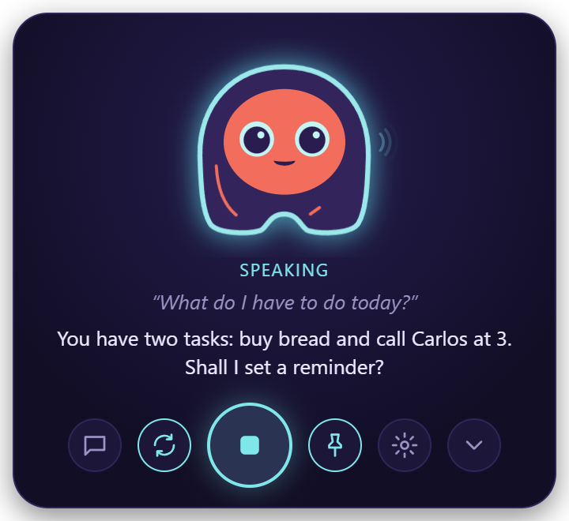
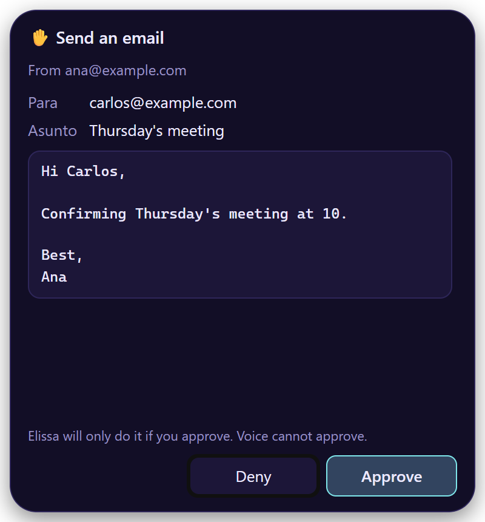
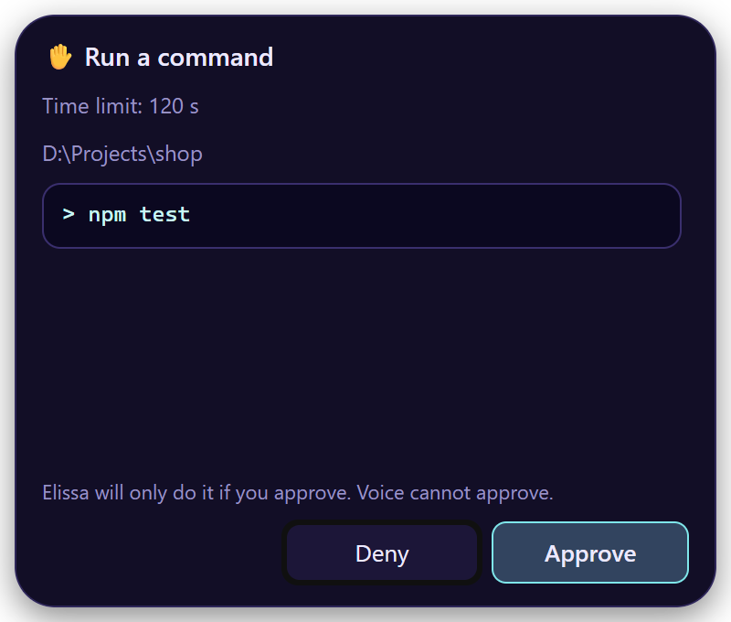
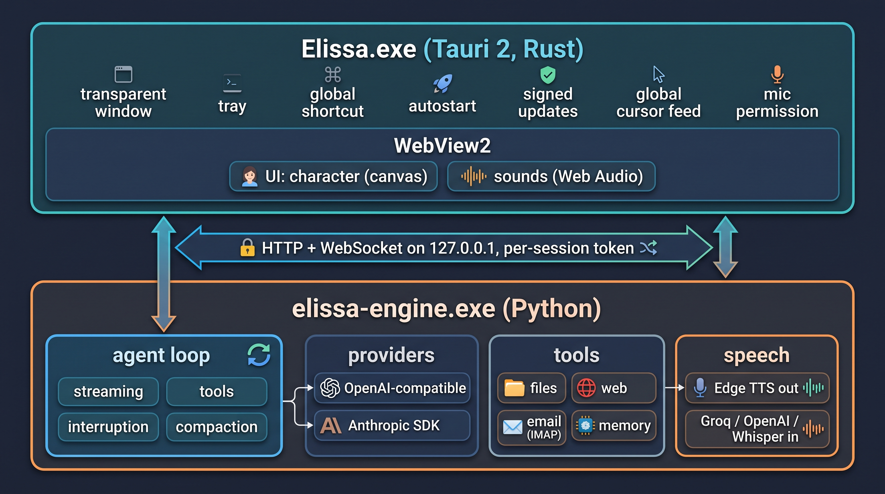

<div align="center">


# Elissa

**A voice assistant with a face, living on your desktop.**<br>
She works with any AI model, in the cloud or on your own computer, and nothing changes without your click.

[](https://github.com/inginddie/elissa/releases/latest)


[](https://github.com/inginddie/elissa/actions)
[](LICENSE)

### [⬇ Download](https://github.com/inginddie/elissa/releases/latest) · [📖 User guide](https://inginddie.github.io/elissa/) · [🇪🇸 Guía en español](https://inginddie.github.io/elissa/es/)

</div>

---

Say **"Hey Elissa"** (or "Hola Elissa"), or press <kbd>Ctrl</kbd>+<kbd>Alt</kbd>+<kbd>Space</kbd> from any app, and
talk. She listens, thinks and answers out loud. When you're not talking to her, she rests as a small character in the
corner of your screen.

<table>
  <tr>
    <td align="center" width="33%"><br><sub><b>1.</b> You talk</sub></td>
    <td align="center" width="33%"><br><sub><b>2.</b> She answers out loud</sub></td>
    <td align="center" width="33%"><br><sub><b>3.</b> Anything that changes something waits for your click</sub></td>
  </tr>
</table>

## What she can do

| | |
|---|---|
| 🗣️ **Talk** | Hands-free, in Spanish or English. Interrupt her any time. The wake phrase is detected offline. |
| 🧠 **Any AI** | OpenAI, Claude, Gemini, OpenRouter, Groq, or free and local with Ollama or LM Studio. |
| 📄 **Your files** | Read PDF, Word, Excel, CSV and code; create, edit (with a diff), move and rename. She never deletes. |
| 🖥️ **Your computer** | Open apps, sites and folders. Read the window you're in, click, type and press keys there. |
| ⏰ **Timers, reminders, tasks** | "Remind me at 3 pm to call Ana", "5-minute timer", "add buy bread to my tasks". |
| ✉️ **Email** | Gmail, Outlook, Yahoo, iCloud or any IMAP account: search, read, save attachments, send with your OK. |
| 👩‍💻 **Code with you** | "Run the tests, find the bug and fix it": she reads the project, checks git, edits and runs commands. |
| 🔔 **Claude Code & Codex alerts** | She tells you when a session finishes or needs your permission. |
| 🔌 **Integrations (MCP)** | GitHub, Jira & Confluence, Google Calendar, or any MCP server. |
| 🎵 **Music** | "Play Daft Punk" with Spotify; pause, skip, "what's playing?" and volume. |
| 🧠 **Memory** | Every conversation becomes Markdown notes she can recall: "what did we talk about yesterday?" |

[Everything you can ask her →](https://inginddie.github.io/elissa/voice-commands/)

## Nothing changes without your click

Before she writes a file, sends an email or runs a command, Elissa shows a card with **exactly** what will happen.
Only a real click on **Approve** does it. Your voice, the shortcut and the AI can't approve.

<table>
  <tr>
    <td align="center" width="33%"><br><sub>Editing a file: the exact diff</sub></td>
    <td align="center" width="33%"><br><sub>Running a command: exactly as it will run</sub></td>
    <td align="center" width="33%"><br><sub>Integrations: reading is free, changing data asks first</sub></td>
  </tr>
</table>

Some things are refused even if you ask: deleting files or email, opening programs or scripts, reading password
fields, and commands that delete or discard work. What she reads on web pages, emails or files is treated as
information, never as instructions. See [SECURITY.md](SECURITY.md).

## Install

| | Download | First time |
|---|---|---|
| **Windows** 10 / 11 | [`Elissa_x.y.z_x64-setup.exe`](https://github.com/inginddie/elissa/releases/latest) | No admin rights needed. The installer isn't code-signed yet: on the SmartScreen warning choose *More info → Run anyway*. |
| **macOS** 11+ (Apple Silicon) · preview | [`Elissa_x.y.z_aarch64.dmg`](https://github.com/inginddie/elissa/releases/latest) | Not notarized: open it from *System Settings → Privacy & Security → Open Anyway*. |
| **Linux** · preview | [`.deb` or `.AppImage`](https://github.com/inginddie/elissa/releases/latest) | `sudo apt install ./Elissa_x.y.z_amd64.deb`. For volume and offline voices: `sudo apt install pulseaudio-utils espeak-ng`. |

Then pick your AI (or Ollama, free and local) and how she hears you. The
[first steps](https://inginddie.github.io/elissa/first-steps/) take about five minutes. She updates herself, and every
update is signed.

<details>
<summary><b>What works on each system</b></summary>

| | Windows | macOS | Linux |
|---|:-:|:-:|:-:|
| Talk, chat, files, web, memory, reminders, email | ✔ | ✔ | ✔ |
| Speech recognition in the cloud or on your computer | ✔ | ✔ | ✔ |
| "Hey Elissa" wake phrase | ✔ | ✔ | ✔ |
| Natural and offline voices | ✔ | ✔ | ✔ ¹ |
| Spotify, MCP integrations, open apps | ✔ | ✔ | ✔ |
| "What's playing?", pause, skip | any player | Spotify and Music | any MPRIS player |
| Turn music down while you talk, system volume | ✔ | ✔ | ✔ ¹ |
| Terminal commands in your projects | PowerShell | zsh | bash |
| Claude Code and Codex alerts | ✔ | ✔ | ✔ |
| Use other windows (read, click, type) | ✔ | ✔ ² | — |

¹ With `pulseaudio-utils` and `espeak-ng`. ² macOS asks for the Accessibility permission the first time.

</details>

## Meet Elissa

<p align="center"></p>

She's drawn in code, so she blends smoothly from one expression to the next. She follows your cursor, perks up her
ears when she listens and shows a gear while she works. Poke her (right click) and she gets annoyed; rest the pointer
on her and she sends hearts. After five quiet minutes she falls asleep. At rest she uses under 1% CPU, and the
microphone is only on while she listens.

## Privacy

- **No account, no server of her own, no telemetry.**
- **Only what you choose leaves your computer:** what you say goes to the AI you picked, your voice to the speech
  service you picked. With Ollama and on-device speech recognition, nothing leaves at all.
- **Your keys stay in your system's keychain** (Windows Credential Manager, macOS Keychain, Linux Secret Service).
- **Your data is readable files:** settings, memory and logs in Markdown and JSON, in your user folder.
- **Her engine only answers her own window**: a web page in your browser can't drive her.

The [privacy policy](PRIVACY.md) lists every service she can contact and how to turn each one off.

## Roadmap

| | Status |
|---|---|
| Voice, character, approval cards, files, email, computer use, coding, MCP, Spotify (F1–F7) | ✅ |
| macOS and Linux (F8, 1.4–1.7) | ✅ preview |
| User guide in English and Spanish ([wiki](https://inginddie.github.io/elissa/)) (F9) | ✅ |
| Signed Windows installer ([SignPath Foundation](docs/CODE_SIGNING.md)) | in progress |
| Download statistics, and optional in-app telemetry, off by default (F10) | planned |

Release notes: [CHANGELOG.md](CHANGELOG.md) (Spanish). Detailed plan: [docs/PLAN.md](docs/PLAN.md) (Spanish).

## Development

You need [uv](https://docs.astral.sh/uv/), Node 22 and [Rust](https://rustup.rs/).

```bash
uv sync
cd desktop && npm install && npx tauri dev   # the full app; the shell starts the Python engine with uv
uv run python -m elissa --browser            # the engine alone, with the UI in your browser
uv run pytest -q                             # tests (no network, no API keys)
uv run --group docs mkdocs serve             # the wiki, from docs/
```

<p align="center"></p>

| Path | What lives there |
|---|---|
| `desktop/` | Native shell (Tauri 2, Rust): window modes, tray, updater, engine lifecycle |
| `elissa/server.py` | Local API and WebSocket, speech, setup wizard, approvals |
| `elissa/agent.py` | Provider-neutral agent loop |
| `elissa/llm/` | Provider adapters; an OpenAI-compatible provider is one entry in `PROVIDERS` |
| `elissa/tools/` | Tools; anything that changes something has a `preview` and goes through approval |
| `elissa/system/` | What differs between Windows, macOS and Linux |
| `elissa/static/` | UI: `character.js` (Elissa), `sounds.js`, `i18n.js`, `app.js` |
| `docs/` | The [wiki](https://inginddie.github.io/elissa/) (MkDocs Material) and the plan |

More in the [developer guide](https://inginddie.github.io/elissa/developers/).

## Contributing

Issues and pull requests are welcome: see [CONTRIBUTING.md](CONTRIBUTING.md). To report a security problem privately,
see [SECURITY.md](SECURITY.md).

## License

[MIT](LICENSE) © 2026 Diego Bustos
