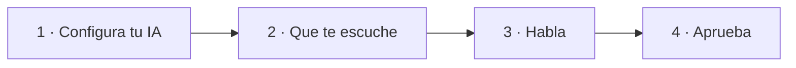
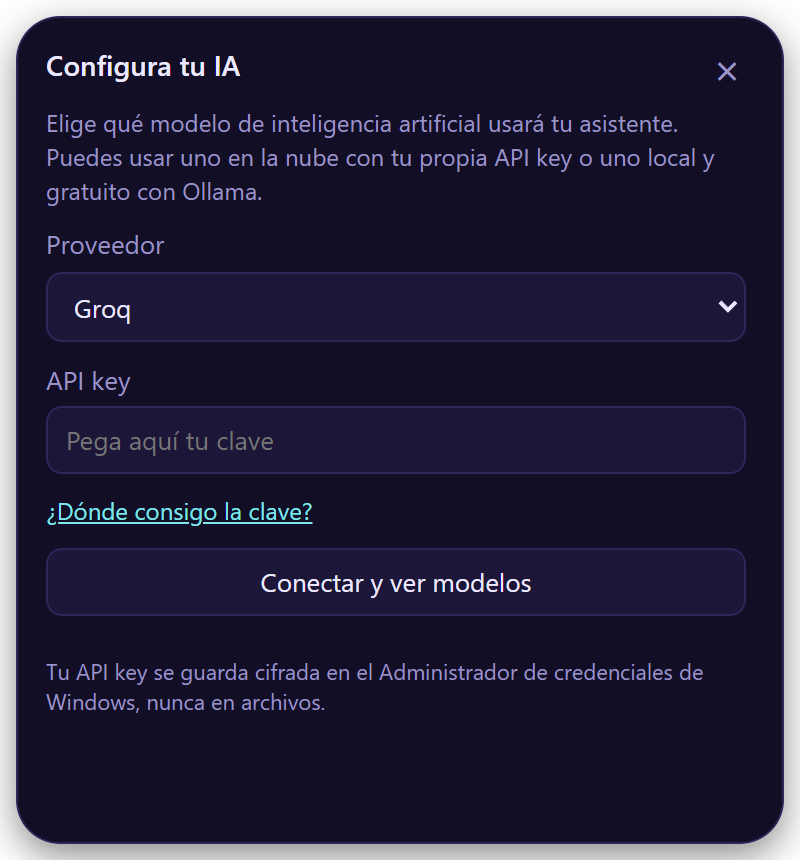
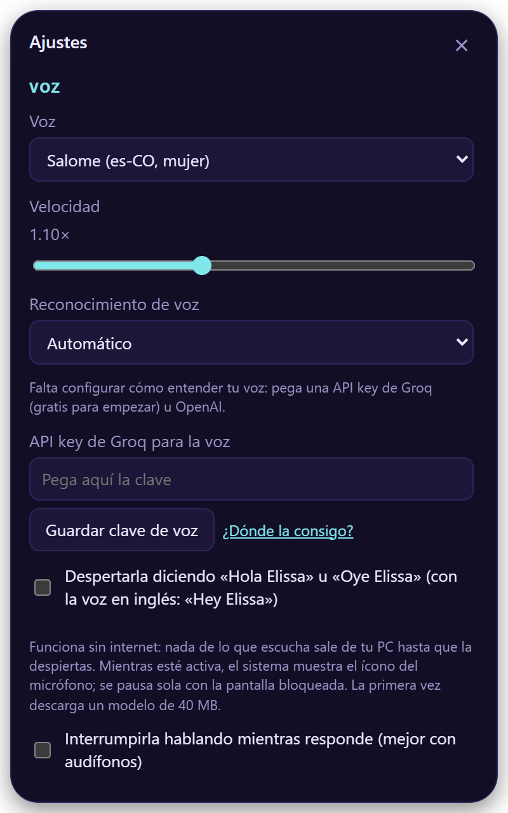
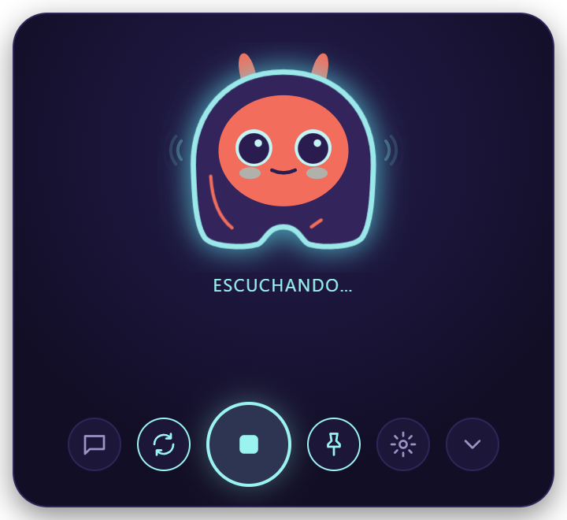
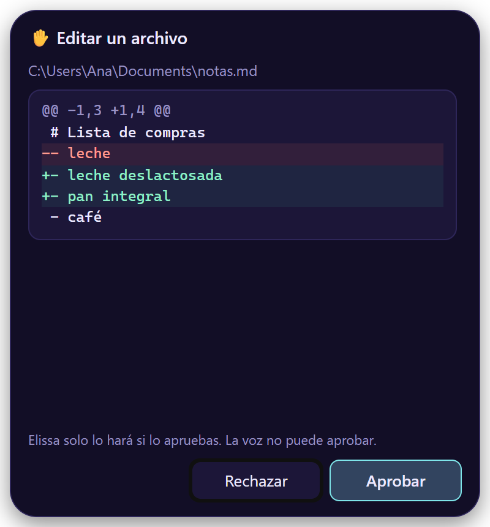

# Primeros pasos

Cuatro pasos, unos cinco minutos.

## 1. Configura tu IA

<figure class="shot" markdown>

</figure>

La primera vez, Elissa abre **Configura tu IA**:

1. Elige un **proveedor**.
2. Pega tu **API key** (*¿Dónde la consigo?* te lleva allá).
3. **Conectar y ver modelos**, elige uno, y **Guardar y probar**.

!!! tip "¿Sin clave? No hay problema"
    Elige **Ollama** o **LM Studio**: gratis, y todo se queda en tu computador. Primero instala
    [Ollama](https://ollama.com) o [LM Studio](https://lmstudio.ai).

Tu clave va al llavero de tu sistema, nunca a un archivo.

??? info "Todos los proveedores"

    | Proveedor | Clave | Notas |
    |---|:-:|---|
    | OpenAI | :material-check: | Modelos GPT |
    | Anthropic | :material-check: | Modelos Claude |
    | Google Gemini | :material-check: | |
    | OpenRouter | :material-check: | Cientos de modelos con una sola clave |
    | Groq | :material-check: | Muy rápido; también el servicio de voz recomendado |
    | Ollama | — | Gratis y local |
    | LM Studio | — | Gratis y local |
    | Otro compatible con OpenAI | opcional | Indícale su URL |

## 2. Que te escuche

<figure class="shot" markdown>

</figure>

Abre *Ajustes* (:material-cog-outline:) → **Voz** → **Reconocimiento de voz**:

| Opción | |
|---|---|
| **Groq** | Rápido y económico, gratis para empezar. [Consigue una clave](https://console.groq.com/keys) |
| **OpenAI** | [Consigue una clave](https://platform.openai.com/api-keys) |
| **En tu PC** | Privado y sin internet |
| **Servidor propio** | Cualquier URL compatible con Whisper |

Pega la clave en **API key para la voz** y elige **Guardar clave de voz**.

## 3. Habla

<figure class="shot" markdown>

</figure>

| Para… | Haz |
|---|---|
| Hablar | ++ctrl+alt+space++, clic en su cara, o di «Hola Elissa» |
| Callarla | ++esc++ |
| Terminar | «Listo, gracias» |
| Escribir | :material-message-outline: |
| Esconderla | :material-chevron-down: o «escóndete» |
| Preguntar por un archivo | Suéltalo sobre ella |

Sigue escuchando después de cada respuesta, así que puedes seguir hablando.

!!! tip "Despiértala con la voz"
    Activa *Ajustes → Voz → Despertarla diciendo…*. Funciona sin internet y se pausa con la pantalla bloqueada.

## 4. Aprueba lo que hace

<figure class="shot" markdown>

</figure>

Antes de cambiar algo, Elissa muestra una tarjeta con **exactamente** lo que va a pasar. Solo tu clic en
**Aprobar** lo hace; ++esc++ o **Rechazar** lo cancela.

Ni tu voz, ni el atajo, ni la IA pueden aprobar.

Sigue con: [todo lo que le puedes pedir](voice-commands.md) · [Ajustes](settings.md)
