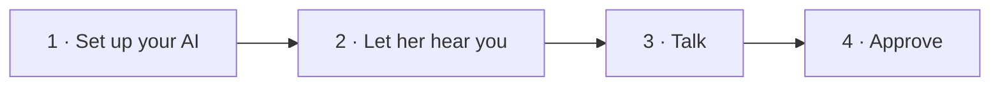
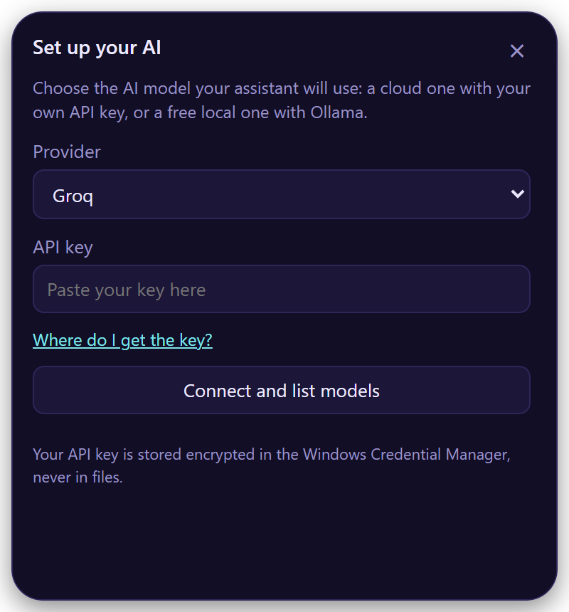
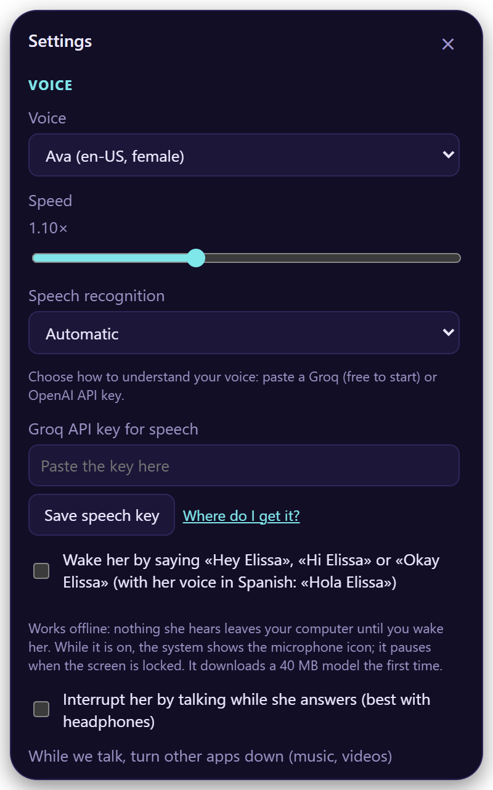
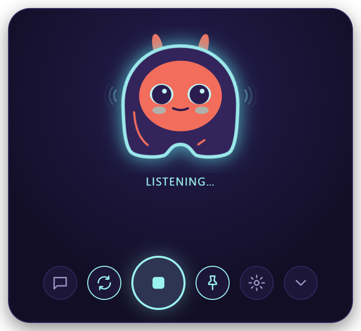
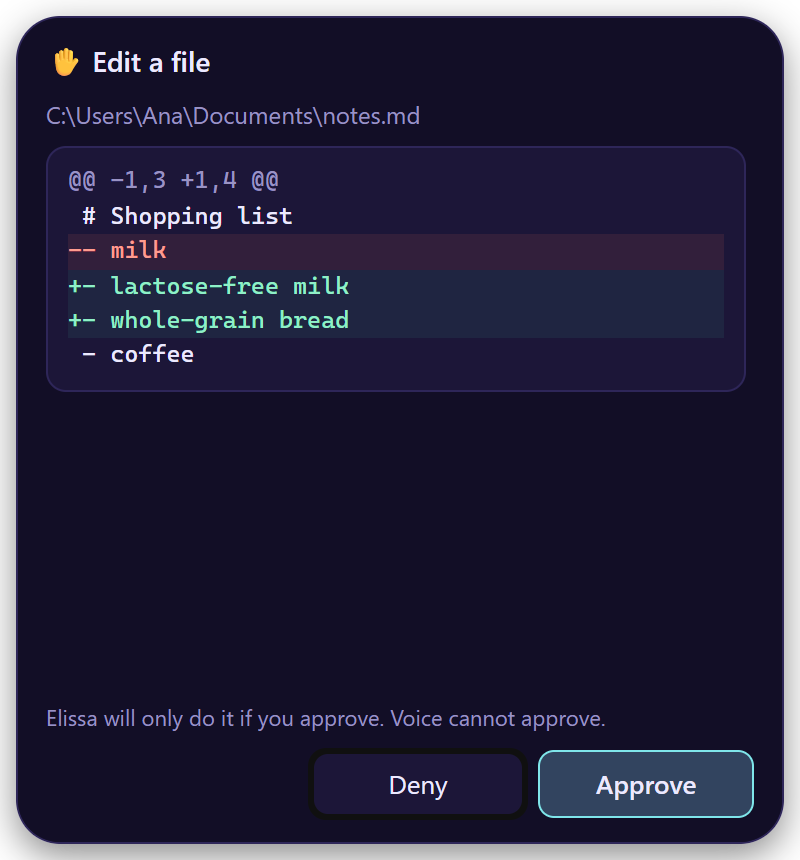

# First steps

Four steps, about five minutes.

## 1. Set up your AI

<figure class="shot" markdown>

</figure>

The first time, Elissa opens **Set up your AI**:

1. Pick a **provider**.
2. Paste your **API key** (*Where do I get the key?* takes you there).
3. **Connect and list models**, pick one, and **Save and test**.

!!! tip "No key? No problem"
    Pick **Ollama** or **LM Studio**: free, and everything stays on your computer. Install
    [Ollama](https://ollama.com) or [LM Studio](https://lmstudio.ai) first.

Your key goes to your system's keychain, never to a file.

??? info "All providers"

    | Provider | Key | Notes |
    |---|:-:|---|
    | OpenAI | :material-check: | GPT models |
    | Anthropic | :material-check: | Claude models |
    | Google Gemini | :material-check: | |
    | OpenRouter | :material-check: | Hundreds of models behind one key |
    | Groq | :material-check: | Very fast; also the recommended speech service |
    | Ollama | — | Free and local |
    | LM Studio | — | Free and local |
    | Other OpenAI-compatible server | optional | Point Elissa at its URL |

## 2. Let her hear you

<figure class="shot" markdown>

</figure>

Open *Settings* (:material-cog-outline:) → **Voice** → **Speech recognition**:

| Option | |
|---|---|
| **Groq** | Fast and cheap, free to start. [Get a key](https://console.groq.com/keys) |
| **OpenAI** | [Get a key](https://platform.openai.com/api-keys) |
| **On your PC** | Private and offline (Windows) |
| **Your own server** | Any Whisper-compatible URL |

Paste the key in **API key for speech** and choose **Save speech key**.

## 3. Talk

<figure class="shot" markdown>

</figure>

| To… | Do |
|---|---|
| Talk | ++ctrl+alt+space++, click her face, or say "Hey Elissa" |
| Stop her | ++esc++ |
| End | "Thanks, that's all" |
| Type | :material-message-outline: |
| Hide | :material-chevron-down: or "hide" |
| Ask about a file | Drop it on her |

She keeps listening after each answer, so you can just keep talking.

!!! tip "Wake her by voice"
    Turn on *Settings → Voice → Wake her by saying…*. It works offline and pauses while your screen is locked.

## 4. Approve what she does

<figure class="shot" markdown>

</figure>

Before changing anything, Elissa shows a card with **exactly** what will happen. Only your click on **Approve**
does it; ++esc++ or **Deny** cancels it.

Your voice, the shortcut and the AI can't approve.

Next: [everything you can ask her](voice-commands.md) · [Settings](settings.md)
