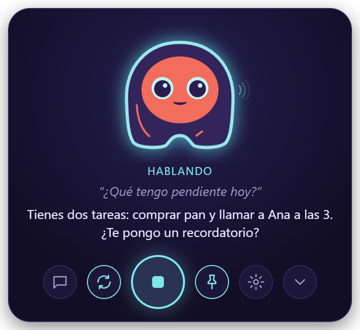
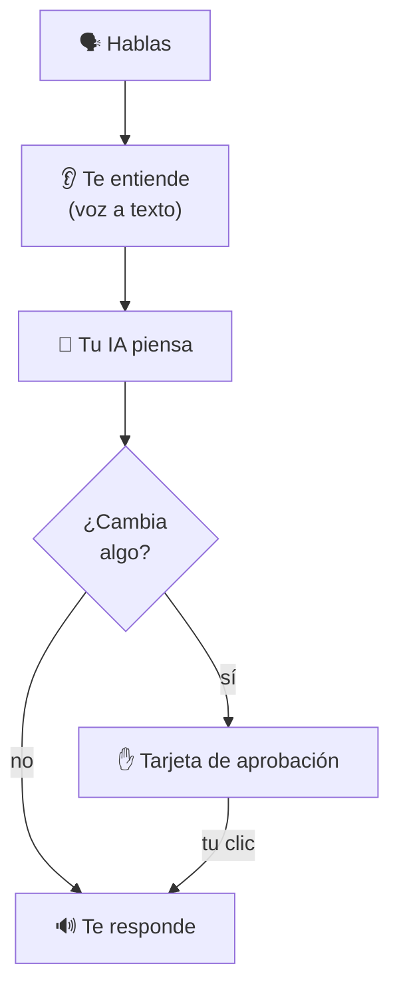

---
hide:
  - navigation
---

# Elissa

{ .skip-lightbox }

**Una asistente de voz con cara que vive en tu escritorio.** Di «Hola Elissa» o presiona ++ctrl+alt+space++, y
habla. Te responde en voz alta, con cualquier modelo de IA, y nada cambia sin tu clic.

[Instalar Elissa](install.md){ .md-button .md-button--primary }
[Primeros pasos](first-steps.md){ .md-button }

## Cómo funciona

<figure class="shot" markdown>

</figure>

Leer, buscar y responder pasan solos. Escribir, enviar, hacer clic o ejecutar algo te muestra antes una tarjeta, y
solo tu clic lo aprueba.

## Qué puede hacer

- :material-account-voice: **Hablar** sin manos, e interrumpirla cuando quieras
- :material-brain: **Cualquier IA**: OpenAI, Claude, Gemini, OpenRouter, Groq, o gratis y local con Ollama
- :material-file-document: **Tus archivos**: lee PDF, Word, Excel; escribe con un diff; nunca borra
- :material-monitor: **Tu computador**: abre apps y sitios; en Windows, usa otras ventanas
- :material-alarm: **Temporizadores, recordatorios y tareas**
- :material-email: **Correo**: busca, lee y envía con tu permiso
- :material-code-braces: **Código**: entiende un proyecto, edita, corre tus pruebas
- :material-spotify: **Música**: Spotify, pausar, siguiente, volumen
- :material-puzzle: **Integraciones**: GitHub, Jira, Confluence, Google Calendar
- :material-bell: **Avisos de Claude Code y Codex**
- :material-head-lightbulb: **Memoria**: «¿de qué hablamos ayer?»
- :material-shield-check: **Privada**: sin cuenta, sin telemetría

[Todo lo que le puedes pedir](voice-commands.md){ .md-button }

## Conoce a Elissa

Sigue tu cursor, para las orejas cuando escucha y muestra un engranaje mientras trabaja. Tócala (clic derecho) y se
molesta; deja el puntero sobre ella y te manda corazones.

## Sistemas

| | Windows 10 / 11 | macOS 11+ (Apple Silicon) | Linux |
|---|:-:|:-:|:-:|
| Estado | Completo | Vista previa | Vista previa |

[Qué funciona en cada sistema](install.md#que-funciona-en-cada-sistema) ·
[Política de privacidad](privacy.md) · [Seguridad](security.md) ·
[Política de firma de código](code-signing.md) (*Code signing policy*)
