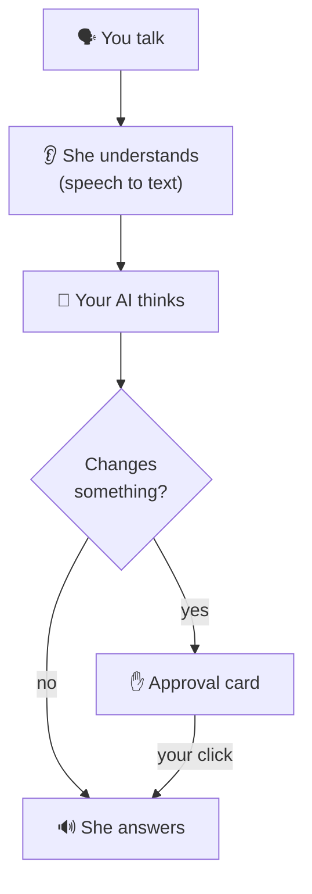

---
hide:
  - navigation
---

# Elissa

{ .skip-lightbox }

**A voice assistant with a face, living on your desktop.** Say "Hey Elissa" or press ++ctrl+alt+space++, and talk.
She answers out loud, with any AI model, and nothing changes without your click.

[Install Elissa](install.md){ .md-button .md-button--primary }
[First steps](first-steps.md){ .md-button }

## How it works

<figure class="shot" markdown>

</figure>

Reading, searching and answering happen on their own. Writing, sending, clicking or running anything shows you a
card first, and only your click approves it.

## What she can do

- :material-account-voice: **Talk**, hands-free, and interrupt her any time
- :material-brain: **Any AI**: OpenAI, Claude, Gemini, OpenRouter, Groq, or free and local with Ollama
- :material-file-document: **Your files**: read PDF, Word, Excel; write with a diff; never delete
- :material-monitor: **Your computer**: open apps and sites; on Windows, use other windows
- :material-alarm: **Timers, reminders and tasks**
- :material-email: **Email**: search, read, and send with your OK
- :material-code-braces: **Code**: understand a project, edit, run your tests
- :material-spotify: **Music**: Spotify, pause, skip, volume
- :material-puzzle: **Integrations**: GitHub, Jira, Confluence, Google Calendar
- :material-bell: **Claude Code and Codex alerts**
- :material-head-lightbulb: **Memory**: "what did we talk about yesterday?"
- :material-shield-check: **Private**: no account, no telemetry

[Everything you can ask her](voice-commands.md){ .md-button }

## Meet Elissa

She follows your cursor, perks up her ears when she listens and shows a gear while she works. Poke her (right click)
and she gets annoyed; rest the pointer on her and she sends hearts.

## Systems

| | Windows 10 / 11 | macOS 11+ (Apple Silicon) | Linux |
|---|:-:|:-:|:-:|
| Status | Full | Preview | Preview |

[What works on each system](install.md#what-works-on-each-system) ·
[Privacy policy](privacy.md) · [Security](security.md) · [Code signing policy](code-signing.md)
