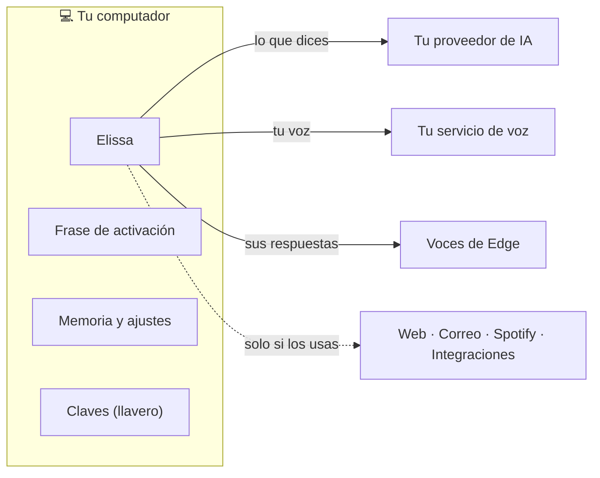

# Política de privacidad

<small>Cada flecha va solo al servicio que elegiste, y cada una se puede evitar: mira la tabla.</small>

Elissa corre en tu computador. No tiene cuenta, ni servidor propio, ni telemetría. Tus ajustes, memoria y registros se
quedan en tu computador como Markdown y JSON legibles (en `%APPDATA%\Elissa` en Windows,
`~/Library/Application Support/Elissa` en macOS y `~/.local/share/Elissa` en Linux), y tus claves se quedan en el
llavero de tu sistema (Administrador de credenciales de Windows, Llavero de macOS o Secret Service de Linux).

Algunas funciones solo sirven contactando un servicio. Elissa contacta un servicio solo para una función que usas, y
solo el servicio que elegiste. Cada uno se puede apagar.

| Qué sale de tu computador | A dónde va | Cuándo | Cómo evitarlo |
|---|---|---|---|
| Lo que dices o escribes, la conversación, y lo que Elissa lee para ti (archivos, páginas, correos, ventanas) | El proveedor de IA que elegiste (OpenAI, Anthropic, Google, Groq, OpenRouter, o tu propio servidor) | Cada vez que le hablas | Elige Ollama o LM Studio: el modelo corre en tu computador |
| Las grabaciones de tu voz | El servicio de reconocimiento de voz que elegiste (Groq, OpenAI o tu propio servidor) | Cada vez que le hablas | *Ajustes → Voz → En tu PC* (whisper.cpp) |
| El texto de sus respuestas | El servicio de voz de Microsoft Edge | Cuando habla con una voz natural | Elige una voz sin conexión en *Ajustes → Voz* |
| Búsquedas web y páginas por las que preguntas | DuckDuckGo y esos sitios | Cuando le pides buscar o leer la web | No le pidas búsquedas web |
| Correo | Tu propio servidor de correo (IMAP/SMTP) | Solo si configuras el correo | Deja el correo apagado (así viene) |
| Tus búsquedas y órdenes de reproducción, con tu cuenta de Spotify | Spotify | Solo si conectas Spotify | No lo conectes (así viene) |
| Datos de las integraciones que conectes | Los servidores MCP que agregues (por ejemplo GitHub o Atlassian) | Solo si los agregas | No agregues integraciones |
| Una revisión de versión | GitHub (las versiones de este repositorio) | Cuando la app arranca | — |
| Descarga de modelos | alphacephei.com (frase de activación), GitHub y Hugging Face (reconocimiento de voz en tu PC) | Una vez, cuando activas esas funciones | Déjalas apagadas (así vienen) |

Esos servicios manejan tus datos según sus propias políticas de privacidad.

**Lo que nunca sale de tu computador:**

- La frase de activación. «Hola Elissa» se detecta localmente, y nada se envía hasta que la despiertas.
- Los avisos de Claude Code y Codex. Los hooks solo llegan a Elissa en tu propio computador.
- Tus notas de memoria y tus ajustes.

Preguntas: abre un issue en https://github.com/inginddie/elissa/issues.

*La versión oficial de esta política es la [versión en inglés](https://github.com/inginddie/elissa/blob/main/PRIVACY.md).*
