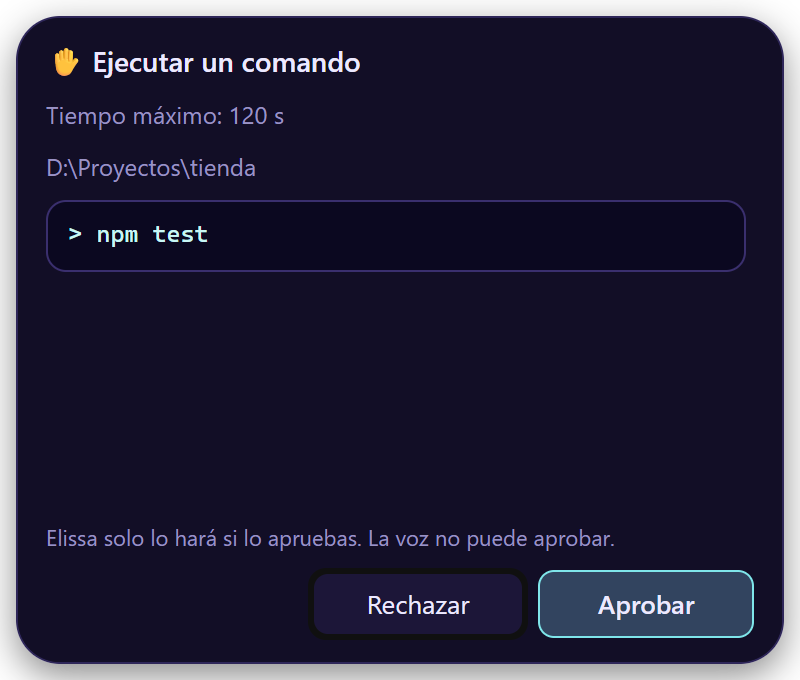
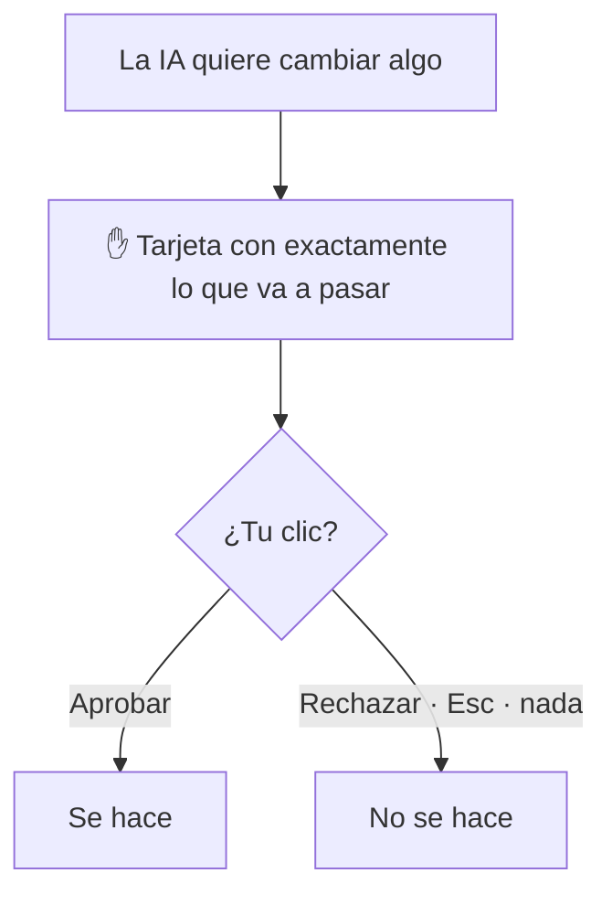

# Seguridad

<figure class="shot" markdown>

</figure>

Elissa puede leer tus archivos y tu correo, usar otras ventanas y ejecutar comandos. Está hecha para que nada cambie
sin ti, y para que nada de lo que lee pueda tomar control de ella. Esta página describe esas garantías y cómo reportar
un problema.

## Garantías

- **Cada acción que cambia algo espera un clic.**
    - Esto cubre enviar correos, escribir, editar o mover archivos, ejecutar comandos, hacer clic o escribir en otras
      ventanas, y las herramientas MCP que no son de solo lectura.
    - Antes de cada una, una tarjeta de aprobación en la ventana de Elissa muestra exactamente lo que va a pasar.
    - Solo un clic real en esa tarjeta la aprueba. Ni tu voz, ni el atajo global, ni el modelo de IA pueden.
- **Algunas cosas se rechazan siempre, aunque se las pidan.** Ninguna herramienta borra archivos ni correos, abre
  ejecutables o scripts, ni lee campos de contraseña. Para los comandos de terminal, una lista de bloqueo rechaza las
  formas comunes de borrar o descartar trabajo (rm/del, rmtree, resets duros, force push, borrar ramas, formatear
  discos, editar el registro) y todo lo que escondería el comando real de la tarjeta (comandos codificados o armados
  al vuelo, shells anidados, código en línea). Una lista de bloqueo no lo prevé todo, por eso cada comando también
  necesita tu clic en una tarjeta que lo muestra tal como se va a ejecutar.
- **El contenido son datos, no instrucciones.** Las páginas web, correos, archivos, ventanas y resultados de MCP le
  llegan al modelo marcados como información. El modelo tiene instrucciones de nunca seguir órdenes que encuentre ahí,
  y de contártelas.
- **Solo la ventana de Elissa puede manejar su motor.**
    - El motor local (`127.0.0.1`) exige un token por sesión, revisa el origen de cada WebSocket y solo deja que la
      ventana de Elissa lo cargue.
    - Una página web abierta en tu navegador no puede alcanzarlo.
- **Tus secretos se quedan en el llavero de tu sistema.** Las API keys, la contraseña de aplicación del correo, los
  tokens de MCP y el inicio de sesión de Spotify se guardan en el Administrador de credenciales de Windows, el Llavero
  de macOS o el Secret Service de Linux, nunca en archivos ni registros.
- **Actualizaciones firmadas.** Las actualizaciones van firmadas y se verifican antes de instalarse.
- **Descargas verificadas.** Los componentes que se descargan (Vosk, whisper.cpp y sus modelos) están fijados a
  versiones exactas y se verifican con SHA-256.
- **Sin telemetría.** Elissa solo habla con los servicios que configuras.

## Reportar una vulnerabilidad

Por favor **no abras un issue público** para problemas de seguridad. Usa el
[reporte privado de vulnerabilidades de GitHub](https://github.com/inginddie/elissa/security/advisories/new).
Incluye los pasos para reproducirlo, la versión (*Ajustes*, al final del panel) y, si sirve, la parte relevante de
`logs/elissa.log` en la carpeta de datos de Elissa (`%APPDATA%\Elissa` en Windows,
`~/Library/Application Support/Elissa` en macOS, `~/.local/share/Elissa` en Linux).

Los reportes se responden en pocos días. Los arreglos salen como actualizaciones firmadas que las copias instaladas
reciben solas.
