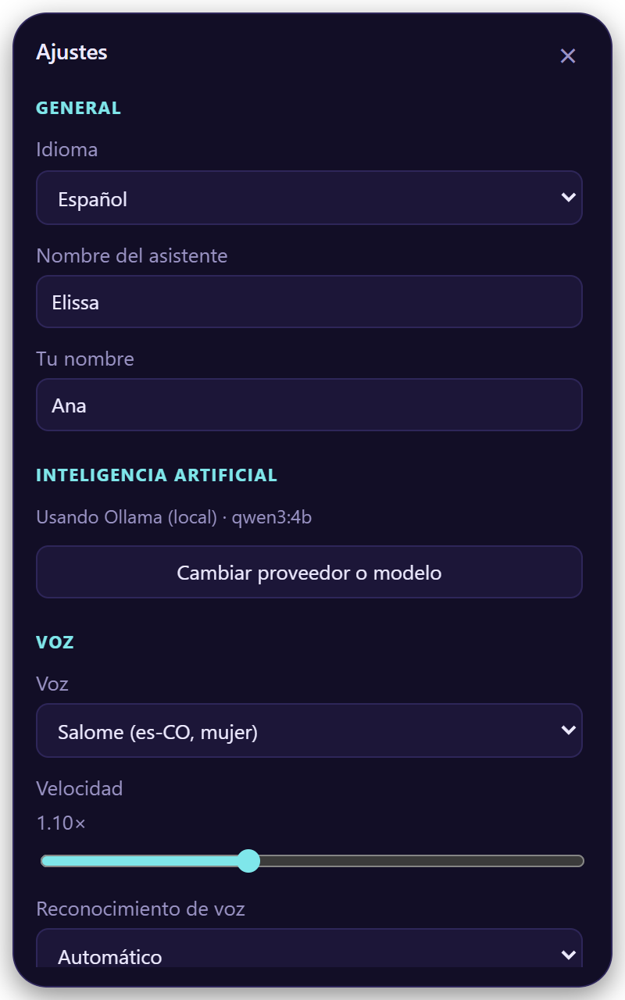
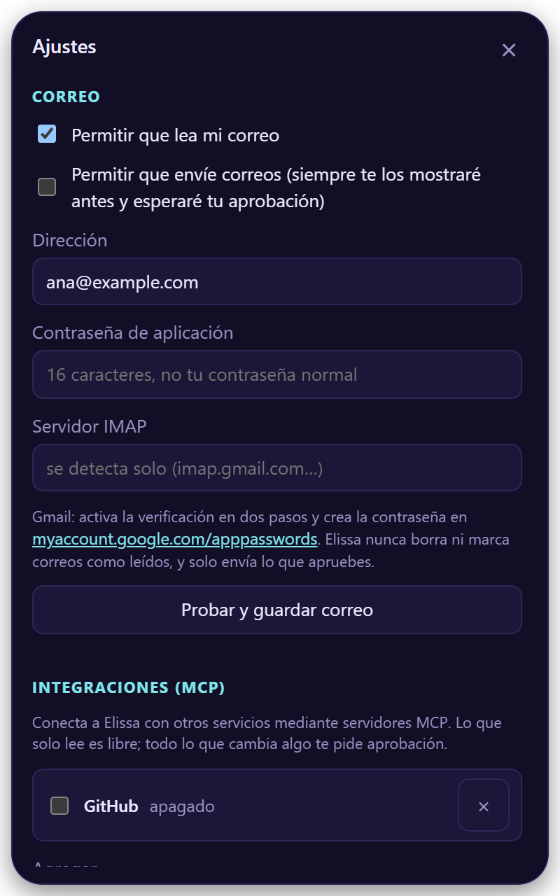
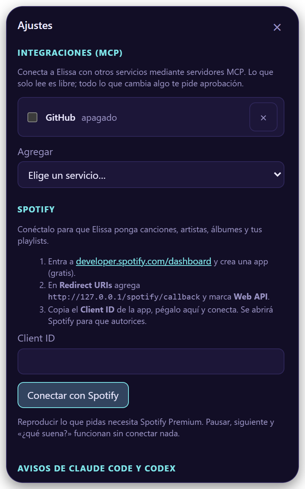
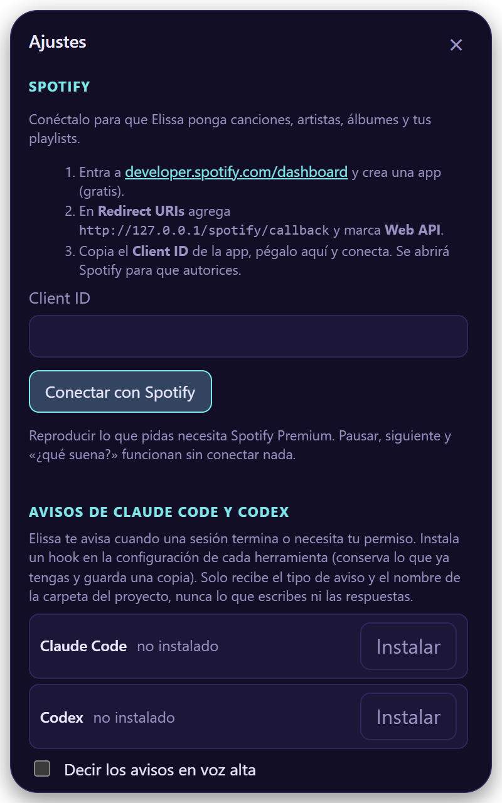
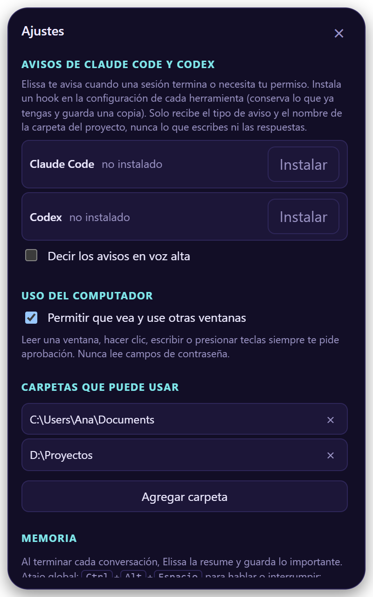

# Ajustes

Ábrelos con :material-cog-outline: en la ventana de Elissa o desde el ícono de la bandeja. Los cambios se guardan
solos. Las secciones que no aplican a tu sistema no aparecen.

## General e IA

<figure class="shot" markdown>

</figure>

- **Idioma**: español o inglés, o automático.
- **Nombre del asistente** y **tu nombre**.
- **Inteligencia artificial**: muestra el proveedor y el modelo en uso. **Cambiar proveedor o modelo** vuelve a abrir
  la [configuración](first-steps.md#1-configura-tu-ia).

## Voz

<figure class="shot" markdown>

</figure>

- **Voz** y **Velocidad** (0,8× a 1,6×).
- **Reconocimiento de voz**: cómo te entiende ([detalles](first-steps.md#2-que-te-escuche)).
- **Despertarla diciendo…**: «Hola Elissa», sin internet.
- **Interrumpirla hablando**: mejor con audífonos.
- **Atajo para hablar**: haz clic y presiona tu combinación.

??? info "Todas las opciones de voz"

    | Opción | Por defecto | Notas |
    |---|---|---|
    | Voz | Salomé (es) / Ava (en) | Voces naturales de Edge, más voces del sistema sin conexión en Windows y macOS |
    | Velocidad | 1,10× | 0,8× a 1,6× |
    | Reconocimiento de voz | Automático | Groq, OpenAI, En tu PC (Windows), Servidor propio |
    | Modelo local | Rápido · 60 MB | O Más preciso · 190 MB. Solo para En tu PC |
    | Despertarla diciendo… | Apagado | «Hola / Oye Elissa» con voz en español; «Hey / Hi / Okay Elissa» con voz en inglés. Descarga 40 MB una vez |
    | Interrumpirla hablando | Apagado | |
    | Bajar las demás apps mientras hablamos | 20 % | 10 %, 20 %, 35 % o no bajarlas. Spotify y Música en macOS; no está en Linux |
    | Conversación continua | Activo | Vuelve a escuchar después de cada respuesta |
    | Siempre visible | Activo | |
    | Iniciar con el sistema | — | |
    | Atajo para hablar | ++ctrl+alt+space++ | Debe incluir ++ctrl++, ++alt++ o la tecla Windows/Comando |

## Sonidos

- **Sonidos de Elissa** activos o no, y su **volumen**.
- **Tus propios sonidos**: elige **Abrir carpeta de sonidos**, deja un `.wav`, `.mp3`, `.ogg` o `.m4a` con el nombre
  del sonido que quieres reemplazar (`listen`, `done`, `greet`, `error`, `approval`…) y elige **Recargar**.

## Correo

<figure class="shot" markdown>

</figure>

1. Activa **Permitir que lea mi correo** (y **Permitir que envíe correos** si quieres).
2. Escribe tu **dirección** y una **contraseña de aplicación**, no tu contraseña normal.
3. **Probar y guardar correo**.

El servidor se detecta para Gmail, Outlook, Yahoo e iCloud. Para Gmail, crea la contraseña en
[myaccount.google.com/apppasswords](https://myaccount.google.com/apppasswords).

Nunca borra correos ni los marca como leídos, y cada correo que envía te lo muestra antes.

## Integraciones (MCP)

<figure class="shot" markdown>

</figure>

Elige una en **Agregar**:

| | Necesitas |
|---|---|
| **GitHub** | Un [token personal](https://github.com/settings/personal-access-tokens) |
| **Jira y Confluence** | [Node.js](https://nodejs.org); entras desde tu navegador |
| **Google Calendar** | Node.js y tu archivo OAuth de Google Cloud |
| **Otro servidor MCP…** | Su URL o comando |

Leer corre libre; cambiar datos te pregunta antes.

!!! warning "Atención"
    Agrega solo servidores en los que confíes: uno local es un programa que corre en tu computador.

## Spotify

<figure class="shot" markdown>

</figure>

1. Crea una app gratis en [developer.spotify.com/dashboard](https://developer.spotify.com/dashboard).
2. Agrega el Redirect URI `http://127.0.0.1/spotify/callback` y marca **Web API**.
3. Pega su **Client ID** y **Conectar con Spotify**.

Poner lo que pidas necesita Spotify Premium. Pausar, siguiente y «¿qué suena?» funcionan sin conectar nada
(Windows y macOS).

## Avisos de Claude Code y Codex

<figure class="shot" markdown>

</figure>

*Windows y macOS.* Elige **Instalar** y Elissa te avisa cuando una sesión termina o necesita tu permiso.

- Conserva tu configuración y guarda una copia (`*.elissa-backup`).
- En Codex, apruébalo una vez con `/hooks`.
- Solo envía el tipo de aviso y el nombre del proyecto.

## Uso del computador

*Windows.* **Permitir que vea y use otras ventanas**: leer la ventana en la que estás, hacer clic, escribir y
presionar teclas, siempre con tu aprobación. Nunca lee campos de contraseña.

## Carpetas que puede usar

Donde puede buscar, leer y escribir archivos. Tu carpeta personal por defecto; **Agregar carpeta** para más. Los
archivos que sueltas sobre ella funcionan desde cualquier lugar.

## Memoria

**Nueva conversación** empieza de cero. Cada conversación queda resumida en notas que puede recordar después. Al final
del panel aparece tu versión y **Actualizar ahora** cuando hay una nueva.
