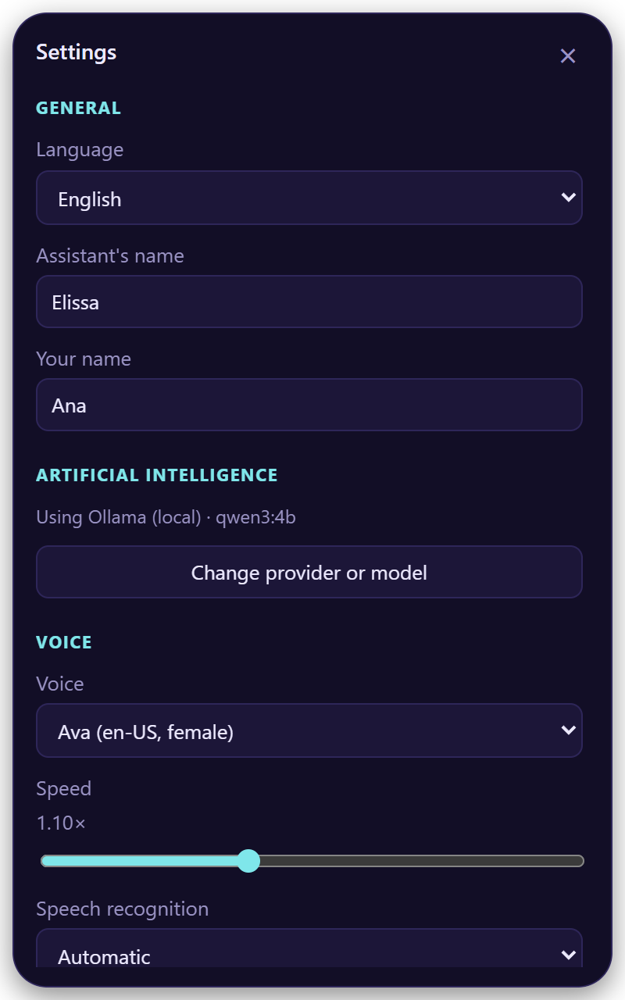
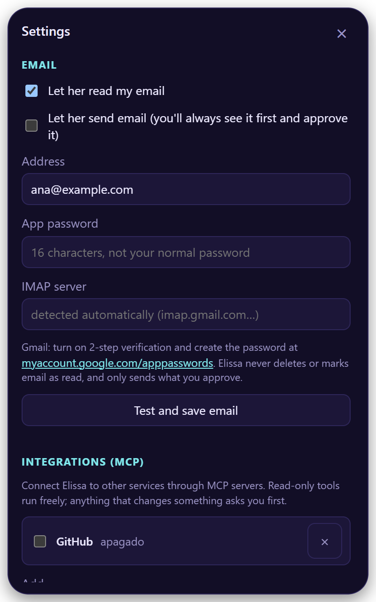
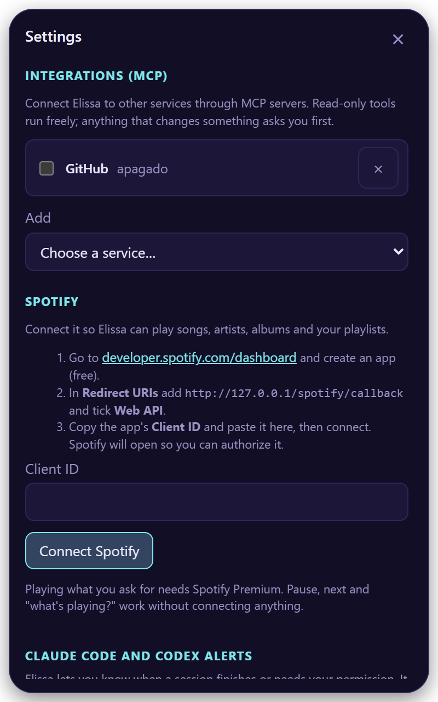
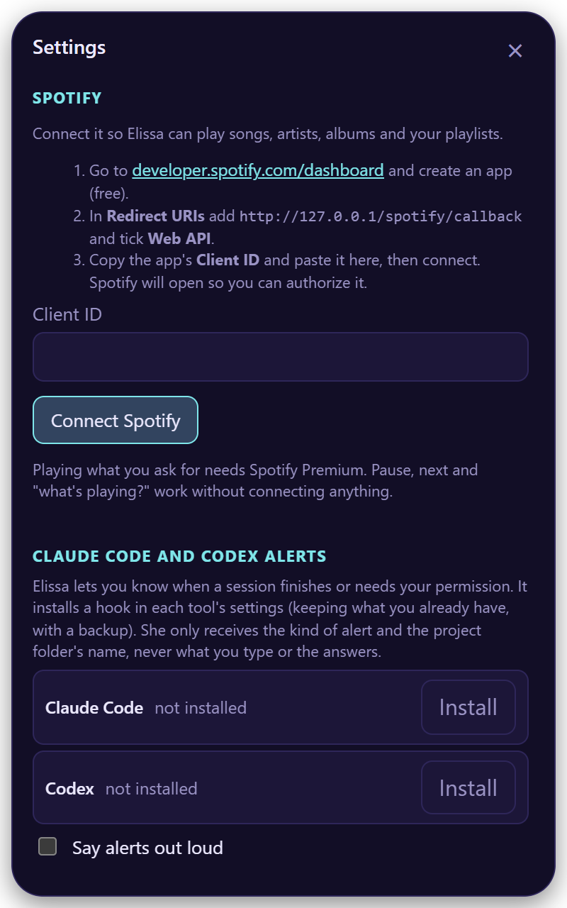
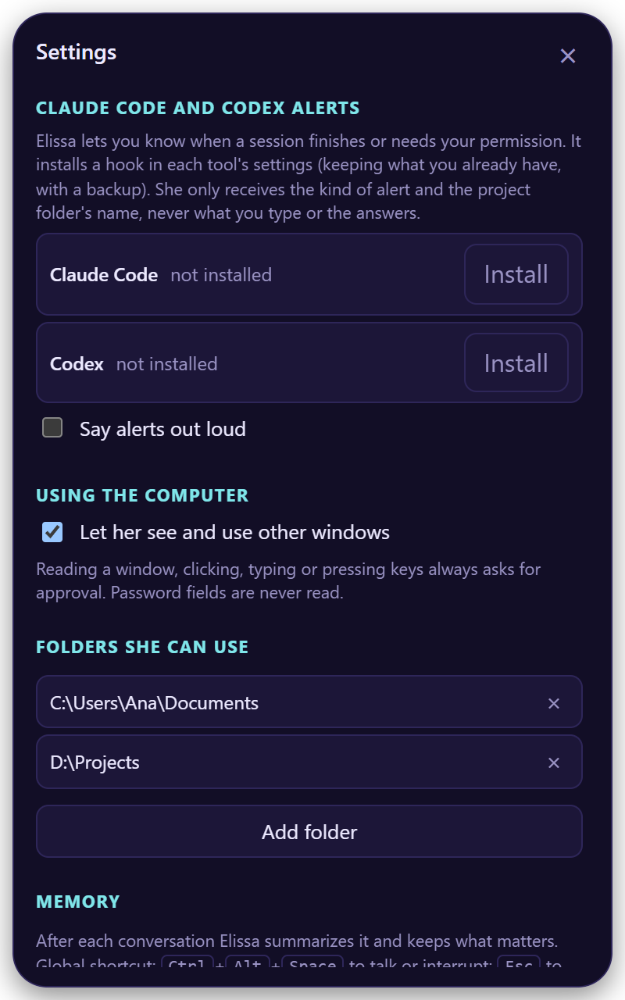

# Settings

Open them with :material-cog-outline: in Elissa's window or from the tray icon. Changes save on their own. Sections
that don't apply to your system don't show up.

## General and AI

<figure class="shot" markdown>

</figure>

- **Language**: Spanish or English, or automatic.
- **Assistant's name** and **your name**.
- **Artificial intelligence**: shows the provider and model in use. **Change provider or model** opens the
  [setup](first-steps.md#1-set-up-your-ai) again.

## Voice

<figure class="shot" markdown>

</figure>

- **Voice** and **Speed** (0.8× to 1.6×).
- **Speech recognition**: how she understands you ([details](first-steps.md#2-let-her-hear-you)).
- **Wake her by saying…**: "Hey Elissa", offline.
- **Interrupt her by talking**: best with headphones.
- **Shortcut to talk**: click it and press your combination.

??? info "All voice options"

    | Option | Default | Notes |
    |---|---|---|
    | Voice | Salomé (es) / Ava (en) | Natural Edge voices, plus offline system voices |
    | Speed | 1.10× | 0.8× to 1.6× |
    | Speech recognition | Automatic | Groq, OpenAI, On your PC, Your own server |
    | Local model | Fast · 60 MB | Or More accurate · 190 MB. Only for On your PC |
    | Wake her by saying… | Off | "Hola / Oye Elissa" with a Spanish voice; "Hey / Hi / Okay Elissa" with an English one. Downloads 40 MB once |
    | Interrupt her by talking | Off | |
    | Turn other apps down while we talk | 20 % | 10 %, 20 %, 35 % or not at all. On macOS, Spotify and Music |
    | Continuous conversation | On | She listens again after each answer |
    | Always on top | On | |
    | Start with the system | — | |
    | Shortcut to talk | ++ctrl+alt+space++ | Must include ++ctrl++, ++alt++ or the Windows/Command key |

## Sounds

- **Elissa's sounds** on or off, and their **volume**.
- **Your own sounds**: choose **Open sounds folder**, drop a `.wav`, `.mp3`, `.ogg` or `.m4a` named like the sound
  you want to replace (`listen`, `done`, `greet`, `error`, `approval`…) and choose **Reload**.

## Email

<figure class="shot" markdown>

</figure>

1. Turn on **Let her read my email** (and **Let her send email** if you want).
2. Type your **address** and an **app password**, not your normal password.
3. **Test and save email**.

The server is detected for Gmail, Outlook, Yahoo and iCloud. For Gmail, create the password at
[myaccount.google.com/apppasswords](https://myaccount.google.com/apppasswords).

She never deletes email or marks it as read, and every email she sends is shown to you first.

## Integrations (MCP)

<figure class="shot" markdown>

</figure>

Pick one in **Add**:

| | You need |
|---|---|
| **GitHub** | A [personal access token](https://github.com/settings/personal-access-tokens) |
| **Jira and Confluence** | [Node.js](https://nodejs.org); you sign in in your browser |
| **Google Calendar** | Node.js and your Google Cloud OAuth file |
| **Other MCP server…** | Its URL or command |

Reading runs freely; changing data asks first.

!!! warning
    Only add servers you trust: a local one is a program running on your computer.

## Spotify

<figure class="shot" markdown>

</figure>

1. Create a free app at [developer.spotify.com/dashboard](https://developer.spotify.com/dashboard).
2. Add the Redirect URI `http://127.0.0.1/spotify/callback` and tick **Web API**.
3. Paste its **Client ID** and **Connect Spotify**.

Playing what you ask for needs Spotify Premium. Pause, next and "what's playing?" work without connecting.

## Claude Code and Codex alerts

<figure class="shot" markdown>

</figure>

Choose **Install** and Elissa tells you when a session finishes or needs your permission.

- It keeps your settings and saves a backup (`*.elissa-backup`).
- In Codex, approve it once with `/hooks`.
- It only sends the kind of alert and the project's name.

## Using the computer

*Windows and macOS.* **Let her see and use other windows**: read the window you're in, click, type and press keys, always
with your approval. Password fields are never read. On macOS, allow Elissa in *Accessibility* when she asks.

## Folders she can use

Where she can find, read and write files. Your home folder by default; **Add folder** for more. Files you drop on her
work from anywhere.

## Memory

**New conversation** starts over. Each conversation is summarized into notes she can recall later. The bottom of the
panel shows your version and **Update now** when there's a new one.
