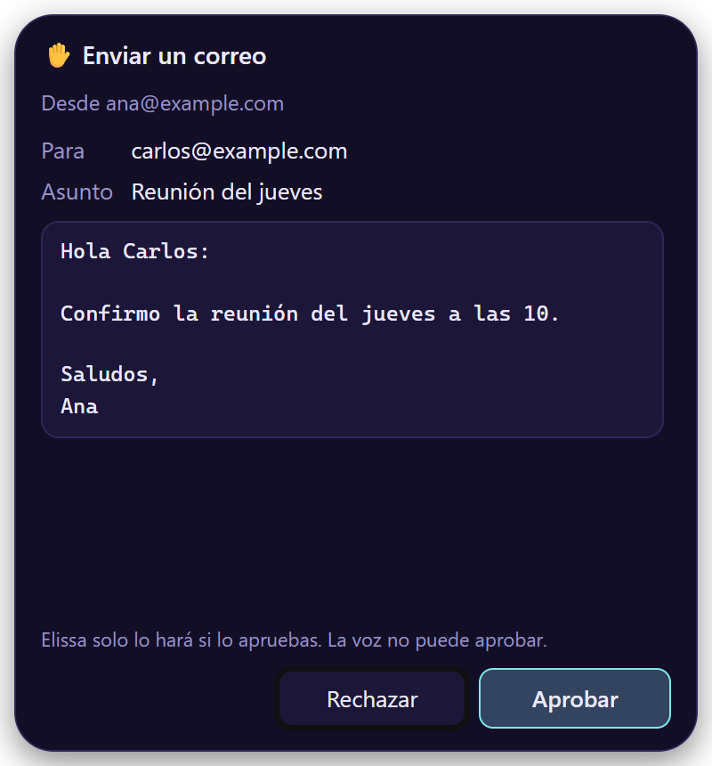

# Comandos de voz

No hacen falta frases exactas: habla con naturalidad, en español o en inglés. ✋ significa que antes te muestra una
tarjeta.

-   :material-chat-outline: **Conversación**

    ---

    «Listo, gracias» · «chao» · «escóndete»

-   :material-music: **Música y volumen**

    ---

    «Pon Soda Stereo» · «pausa» · «salta 3 canciones» · «¿qué suena?» · «volumen al 30»

-   :material-application-outline: **Apps y sitios**

    ---

    «Abre Excel» · «abre github.com» · «abre mi carpeta de Descargas»

-   :material-file-document-outline: **Archivos**

    ---

    «Lee el PDF que acabo de descargar» · «busca los archivos del presupuesto» · «escribe un resumen en notas.md» ✋

-   :material-alarm: **Temporizadores, recordatorios, tareas**

    ---

    «Temporizador de 5 minutos» · «recuérdame a las 3 llamar a Ana» · «agrega comprar pan a mis tareas»

-   :material-web: **Web**

    ---

    «Busca en internet…» · «lee esta página» · «resume este PDF»

-   :material-email-outline: **Correo**

    ---

    «¿Tengo correos de Ana?» · «guarda los adjuntos» · «respóndele que llego a las 5» ✋

-   :material-code-braces: **Código**

    ---

    «¿Qué es este proyecto?» · «¿qué cambió?» · «corre las pruebas y arregla el error» ✋

-   :material-monitor: **Tu computador** (Windows, macOS)

    ---

    «¿Qué es esto?» · «cambia a Excel» · «haz clic en Guardar» ✋ · «presiona Ctrl+S» ✋

-   :material-head-lightbulb-outline: **Memoria**

    ---

    «Recuerda que prefiero las reuniones en la mañana» · «¿de qué hablamos ayer?»

-   :material-puzzle-outline: **Integraciones**

    ---

    «¿Mis issues abiertos en GitHub?» · «crea un ticket en Jira para…» ✋ · «¿qué tengo mañana en el calendario?»

## Cómo se ven las tarjetas ✋

<figure markdown>

<figcaption>Editar un archivo: el diff exacto</figcaption>
</figure>
<figure markdown>

<figcaption>Enviar un correo: el mensaje completo</figcaption>
</figure>
<figure markdown>

<figcaption>Ejecutar un comando: tal como se va a ejecutar</figcaption>
</figure>

## Bueno saber

- **Música:** poner lo que pidas necesita [Spotify conectado](settings.md#spotify). Pausar y siguiente funcionan con
  cualquier reproductor en Windows y Linux, con Spotify y Música en macOS.
- **Tu computador:** Windows y macOS.
- **Correo** necesita [Correo](settings.md#correo) activo.
- **Nunca:** no borra archivos ni correos, no abre programas ni scripts, y no lee campos de contraseña. Los comandos
  que borran o descartan trabajo se rechazan, aunque se lo pidas.
- Los recordatorios muestran una notificación, y te los dice en voz alta.
